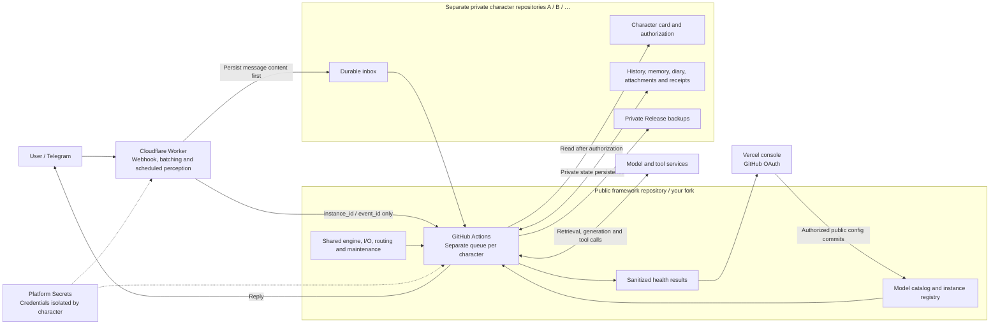
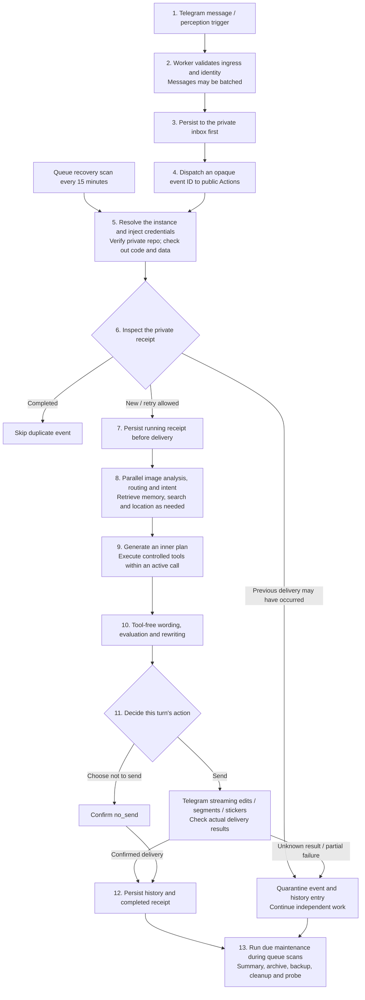

# RP-Core

**One public roleplay framework. Multiple private repositories containing character data only.**

[简体中文](README.md) · [English](README.en.md) · [日本語](README.ja.md)

RP-Core centralizes model integrations, routing, tools, memory, messaging, maintenance, and workflows in a public repository. Character cards, personal conversations, diaries, databases, and runtime state live in separate private repositories. Deployment platforms inject credentials through Secrets. A shared framework update reaches every character in that deployment on subsequent runs.

The project uses **AGPL-3.0-only**. The current package version is **0.3.0**. Tenshi is an independently written example; the original user's private character instructions and personal history are not included.

[Model and health console](https://rp-core-console.vercel.app) · [Full runtime](docs/full-runtime.md) · [Console deployment](docs/console.md) · [Review fixes](docs/review-fixes.md)

## Contents

- [Design and data boundaries](#design-and-data-boundaries)
- [Architecture and execution flow](#architecture-and-execution-flow)
- [Capabilities and runtime modes](#capabilities-and-runtime-modes)
- [Offline quick start](#offline-quick-start)
- [Deploy the full engine](#deploy-the-full-engine)
- [Model configuration and visual console](#model-configuration-and-visual-console)
- [Add characters and upgrade](#add-characters-and-upgrade)
- [Maintenance, backups, and recovery](#maintenance-backups-and-recovery)
- [Development and verification](#development-and-verification)
- [Repository layout, documentation, and licensing](#repository-layout-documentation-and-licensing)

## Design and data boundaries

| Location | Contents |
| --- | --- |
| Public RP-Core repository or your public fork | All execution code, built-in I/O drivers, public model catalog, nonsecret endpoints and routing settings, shared prompt templates, Workers, console, and Actions workflows |
| A separate private repository for each character | Character identity and specific instructions, authorized users, conversations, diaries, knowledge, relationship state, SQLite/vector caches, attachments, sticker catalog, inbox, and execution receipts |
| GitHub Environment / Cloudflare / Vercel Secrets | Model keys, Telegram tokens, private repository credentials, OAuth credentials, and session secrets |
| Public `health/` directory | Allowlisted health results, public model identifiers, timestamps, and numeric statistics; no raw upstream responses or credentials |

A private repository's `io.json` declares a version, data format, and permitted file bindings. New characters do not need copies of Python adapters, model gateways, database implementations, or workflows. Standard deployment does not import private Python modules or load the private repository's `.env`.

Public code must read private data during execution. Owners therefore still need to trust the selected framework commit, Actions, and execution platform. A private repository's visibility does not hide its data from an authorized runtime.

## Architecture and execution flow

### Architecture



The private repository is temporarily checked out on the runner. Message content, databases, and runtime logs are not published as public Actions artifacts. Full-engine backups are uploaded only to Releases in the character repository after verifying that repository is private.

### How a message is processed



The diagram shows the full engine's main boundaries; public configuration controls individual branches. `replied_flag`, nonempty reply text, and successful generation alone do not prove Telegram delivery. Ambiguous delivery is quarantined while independent tasks continue, and the workflow ultimately reports a nonzero exit status. Failure to persist the guard before delivery stops execution immediately.

## Capabilities and runtime modes

### Full engine

`config/runtime/full.json` uses the public compatibility runtime for the existing Tenshi feature set and data layout:

- Claude, GPT, Gemini, Grok, DeepSeek, GLM, and other configured models, with OpenRouter, MagmaRouter, proxies, and failover. Selected adapted routes support Responses.
- Two-stage inner planning and outward expression, intentional silence, streaming edits, segmented replies, stickers, and reactions. Evaluation and rewriting cannot execute write tools.
- Image, document, and audio attachment handling, album batching, quoted messages, web search, weather, and location context. Actual capabilities depend on the selected models and services.
- SQLite, FTS, FAISS, Qwen embeddings, process-local deduplication of identical embedding requests, and batch caching.
- Diaries, partitioned knowledge, summaries, context compression, relationship evidence and reflection, deferred intent, and random/scheduled perception.
- Git persistence and staging recovery, receipt quarantine, log rotation, attachment reference protection, and private backups.

**The full engine supports one user and that user's private Telegram chat per private data repository.** Multiple users or different chat targets are rejected explicitly. Multiple characters use separate repositories and registered instances.

### Choose a configuration

| Configuration | Engine and ingress | Intended use |
| --- | --- | --- |
| `config/runtime/full.json` | Full engine; consumes private inbox, usually fed by `full.mjs` | Full capabilities and existing data reuse |
| `config/runtime/offline.json` | Smaller native engine; scripted model, file output, local persistence | Offline demo without APIs or Telegram |
| `config/runtime/default.json` | Smaller native engine; Telegram polling | Lightweight text roleplay |
| `config/runtime/webhook.json` | Smaller native engine; polling disabled, queued events | Lightweight ingress using `telegram.mjs` |

The `driver` in `io.json` selects the data format; runtime configuration selects the engine. The full engine requires canonical `tenshi-v1` bindings and rejects custom `session_map` or arbitrary path replacements. The native engine retains its mapping support.

## Offline quick start

Install Git, Python **3.11+**, and `uv`. Console development additionally requires Node.js **22.x**.

```bash
git clone https://github.com/Hisou-Tenshi/RP-Core.git
cd RP-Core
uv sync --locked --extra dev
uv run --no-sync rp-core init-instance --path instance --demo-event
uv run --no-sync rp-core run --config config/runtime/offline.json --data-root instance
```

This uses a newly written short Tenshi card, a fictional message, and fixed scripted output. It does not call a real model or send Telegram messages. Output is written to `instance/state/outbox.jsonl`; replaying the same event does not generate another reply. The example demonstrates the native engine's data boundary and idempotency, not every full-engine capability.

## Deploy the full engine

Use this path for your own public fork and private character repository. An existing Tenshi installation does not need to be initialized again.

### 1. Fork and prepare private data

Fork this public repository and enable the required Actions workflows. Create a separate private repository, such as `YOUR_ACCOUNT/tenshi-data`, clone it next to the framework, and run from the framework directory:

```bash
uv sync --locked --extra dev --extra full
uv run --no-sync rp-core init-instance --path ../tenshi-data --driver tenshi-v1
```

Edit `character.json` and `identity.json` in the private repository. A minimal card is shown below; production character instructions belong only in the private repository:

```json
{
  "id": "tenshi-example",
  "name": "Tenshi",
  "instructions": "An independently written Tenshi example. Talk naturally without assuming an existing personal history with the user."
}
```

Replace the example numbers below with your own Telegram user ID, and keep this file private:

```json
{
  "allowed_user_ids": [123456789],
  "telegram": {
    "chat_id": 123456789,
    "allowed_chat_ids": [123456789]
  }
}
```

An empty authorization list does not accept messages. Prepare and inspect the interface with:

```bash
uv run --no-sync rp-core full --task prepare --data-root ../tenshi-data
uv run --no-sync rp-core full --task preflight --data-root ../tenshi-data
```

Commit data to the private repository's `main` branch. `prepare` neither rebuilds an existing database nor overwrites an existing card. Do not rerun `init-instance` against an already initialized I/O directory.

### 2. Register the instance and configure its GitHub Environment

The default instance is registered in `config/instances.json`:

```json
{
  "schema_version": 1,
  "instances": [
    {
      "id": "tenshi",
      "repository_variable": "RP_TENSHI_REPOSITORY",
      "environment": "tenshi",
      "runtime": "config/runtime/full.json"
    }
  ]
}
```

Configure your public fork:

| Type | Name | Value or purpose |
| --- | --- | --- |
| Repository Variable | `RP_TENSHI_REPOSITORY` | `YOUR_ACCOUNT/tenshi-data`; used to select configured instances |
| Repository Variable | `RP_LIVE_ENABLED` | Set to `true` when ready to enable production character workflows |
| GitHub Environment | `tenshi` | Must match the registry; isolates credentials per character |
| Environment Secret | `RP_INSTANCE_TOKEN` | Contents read/write access to the selected private data repository, including private Release backups |
| Environment Secret | `RP_TELEGRAM_TOKEN` | The character's Bot token; legacy `TG_TOKEN` is supported |
| Environment Secret | `OPENROUTER_API_KEY` / `RP_MODEL_API_KEY` | OpenRouter access; the latter is a compatibility alias |
| Environment Secret | `QWEN_API_KEY` | Memory retrieval/writes using Qwen embeddings |
| Environment Secrets | Configured provider and proxy keys | Supply keys for routes you actually enable; every provider is not required |
| Environment Secret | `PERCEPTION_SCHEDULE_SYNC_URL` | The Worker's `/internal/perception-schedule` endpoint |
| Environment Secret | `PERCEPTION_SCHEDULE_SYNC_SECRET` | Must match the Worker's schedule-sync secret |

The full engine receives Telegram input through the Worker/private inbox. `full.json` does not poll Telegram itself. Queue scans can run due maintenance even without incoming messages. Public configuration and workflows define the available providers, proxy parameters, and secret slots; a route without credentials does not gain API access automatically.

### 3. Deploy the Cloudflare ingress

Deploy `integrations/cloudflare/full.mjs` with its dependency modules. For a single-file Dashboard deployment:

```bash
node scripts/build_cloudflare.mjs
```

Deploy the generated `integrations/cloudflare/dashboard-worker.mjs`. Bind a KV namespace named `KV` and configure:

| Type | Name | Purpose |
| --- | --- | --- |
| Variable | `DATA_REPOSITORY` | Your private data repository |
| Variable | `DATA_BRANCH` | `main` |
| Variable | `PUBLIC_REPOSITORY` | Your public fork |
| Variable | `INSTANCE_ID` | A registered ID, such as `tenshi` |
| Variable | `RP_LIVE_ENABLED` | Set to the string `true` after setup |
| Secret | `DATA_TOKEN` | Contents read/write access to the private data repository |
| Secret | `DISPATCH_TOKEN` | Permission to send `repository_dispatch` to your public fork |
| Secret | `TELEGRAM_WEBHOOK_SECRET` | Must match Telegram `setWebhook`'s `secret_token` |
| Secret | `PERCEPTION_SCHEDULE_SYNC_SECRET` | Must match the GitHub schedule-sync secret |

Point the Bot's webhook at your Worker and set the matching `secret_token`. For minute-level perception, separately configure a Worker Cron Trigger, for example once per minute. Random and scheduled perception are not supplied by GitHub's 15-minute recovery scan itself.

The Worker saves the private event before dispatching its public ID. Scheduled entries use separate KV acknowledgement keys so consumption cannot overwrite a concurrent schedule sync. `GET /health` exposes a small status response; control endpoints require schedule-secret authentication.

### 4. Enable and inspect

Stop the old execution path for this character, set `RP_LIVE_ENABLED=true` in both GitHub and the Worker, and inspect **Run private characters**. Run it manually with `instance_id=tenshi` or `all`, or let a webhook dispatch an event. The workflow also scans the durable queue every 15 minutes; scheduled execution is not a real-time service guarantee.

Do not place tokens, message content, or character data in public workflow inputs. Use your own Secrets. Runner, model API, Cloudflare, and Vercel usage and limits are determined separately by those services; this project does not promise permanently free hosting.

## Model configuration and visual console

The full engine's single public model catalog is:

```text
src/rp_core/compat_runtime/model-config.json
```

It defines model IDs, providers, tiers, ordering, OpenRouter mappings, dialogue and summary chains, embedding settings, and allowlisted public connection/reasoning parameters. This is separate from the native engine's `config/runtime/default.json`.

The console in `web/` displays sanitized per-instance health results and saves public model configuration through GitHub OAuth. Renaming a model preserves routing references. Add controls start empty; choosing a candidate requires an explicit Add action.

Deploy your own console:

1. Import your public fork into Vercel. Set Root Directory to `web`, Node.js to `22.x`, install to `npm ci`, build to `npm run build`, and output to `public`.
2. Following `web/.env.example`, configure `RP_PUBLIC_REPOSITORY`, `RP_PUBLIC_BRANCH`, `RP_APP_ORIGIN`, and `RP_ADMIN_IDS`, a list of numeric GitHub administrator IDs.
3. Create your GitHub OAuth App with callback `https://YOUR_DOMAIN/api/auth/callback/github`; store `GITHUB_CLIENT_ID`, `GITHUB_CLIENT_SECRET`, and a random `AUTH_SECRET` in Vercel.
4. Sign in using an allowlisted account that still has push permission on the configured public repository.

OAuth requests `read:user public_repo`. The server restricts writes to its configured public repository and does not request private repository access or read model keys, character cards, or conversations. Saves use the Git blob SHA for conflict detection. New jobs use the committed configuration; running jobs retain the commit they checked out.

**RP provider health** runs on its schedule, manual dispatch, and model-catalog changes. It uses the corresponding instance Environment's keys and publishes `health/<instance>/latest.json` and `history.json`. Checks are non-generating; a green result does not guarantee successful generation, streaming, or tool use.

**Changing the embedding model or dimensions does not migrate existing vectors.** Plan a separate data/index migration for incompatible changes. Adding an SDK or protocol family still requires public code changes. See [console documentation](docs/console.md) for details.

## Add characters and upgrade

Create another private data repository, identity, and `io.json`. Add a public registry entry, its Repository Variable and Environment, and the required Worker bindings/webhook. The shared workflow expands instances into a matrix; each character does not need its own execution code.

Characters in the same public deployment use shared updates on subsequent jobs. Other users' forks must sync upstream. Change character-specific content in private data and fix logic in the public repository. Public configuration can express nonsecret differences; the full engine currently shares one public model-catalog JSON.

Existing Tenshi JSON, SQLite, FTS, vectors, and diaries can be retained. The full engine projects public code and private data into a temporary runtime view. `prepare` extracts literals from a legacy persona without executing private source. See [full runtime](docs/full-runtime.md) and [migration background](docs/tenshi-migration.md).

## Maintenance, backups, and recovery

| Default maintenance | Interval | Result |
| --- | --- | --- |
| Summary | 3 hours | Updates private knowledge, memory, relationship state, and related data |
| History archive | 7 days | Archives historical slices in the existing format |
| Daily backup | 24 hours | Private repository Release; retains 7 daily backups |
| Weekly backup | 7 days | Private repository Release; retains 4 weekly backups |
| Cleanup | 24 hours | Cleans chat fields, compresses/rotates logs, removes old unreferenced attachments |
| Private diagnostic probe | 24 hours | Full-runtime diagnostics; public dashboard probes have their own workflow |

Due maintenance is checked on queue scans without a specific `event_id`, not at guaranteed wall-clock times. After sanitization, active logs reaching 10 MiB are rotated. Daily cleanup rotates the remaining logs and keeps the latest three archive dates. Attachments are kept for at least three days, and files referenced by current/archived JSON are preserved. Unreadable reference data stops deletion.

Backups verify the destination is private before uploading ZIPs. SQLite uses a consistent snapshot API, and backups are not published as public artifacts. Manual backups use `rp-core full --task daily-backup` or `weekly-backup` with the private `--data-root`, appropriate credentials, and explicit `RP_ALLOW_LIVE=1`.

Recovery principles:

- Skip confirmed completed events. Isolate events that may already have reached Telegram; never blindly replay them.
- Reply failures known to occur before delivery and safely retryable maintenance events have bounded queue retries, up to three attempts by default.
- Reconcile private `.rp/full-receipts/`, history, and Telegram before manually correcting the receipt and `rp_delivery_quarantined` marker. Exhausted retry counters require an explicit reset.
- If private main-branch persistence fails, attempt a `bot-staging/*` recovery branch and stop further delivery. Subsequent jobs reconcile staging first. Do not hide conflicts with a force push or database rebuild.
- Cancellation prevents expired work from starting new requests, callbacks, or tool actions. It cannot undo network I/O or writes already started; a process-group hard timeout remains the final boundary.

## Development and verification

```bash
uv sync --locked --extra dev --extra full
uv run --no-sync pytest
uv run --no-sync python scripts/run_compat_tests.py
node --test tests/test_cloudflare*.mjs
uv run --no-sync ruff check .
uv run --no-sync ruff format --check .
uv run --no-sync python scripts/export_schemas.py --check
uv run --no-sync python scripts/audit_public.py
uv run --no-sync python scripts/review_runtime_manifest.py --check
node scripts/build_cloudflare.mjs --check
uv run --no-sync python -m build --no-isolation
```

Console:

```bash
cd web
npm ci
npm test
npm run build
```

Tests use synthetic data, mocks, temporary databases, and local Git remotes. The compatibility suite first validates the current editable catalog, then runs imported regressions against a fixed historical catalog in an isolated environment. Historical hardcoded model IDs therefore do not incorrectly reject valid console renames.

`rp-core full --task shadow` defaults to the offline `selfcheck`. Explicit `--shadow-task probe` accesses real services. `--shadow-task reply` uses real models to generate a synthetic reply and may incur charges, while Telegram delivery is replaced with a shadow transport. Shadow success and passing tests do not establish complete production or load-test coverage.

## Repository layout, documentation, and licensing

```text
src/rp_core/                  Public host, protocol, I/O and execution logic
src/rp_core/compat_runtime/   Full engine, public model catalog and source manifest
config/                      Instance registry and runtime configurations
integrations/cloudflare/     Full/lightweight ingress and Dashboard bundle
web/                         Vercel OAuth model console
health/                      Allowlisted public health results
schemas/                     Versioned JSON Schemas
scripts/                     Build, validation, probe and review tools
tests/                       Framework and ingress regressions
validation/                  Synthetic compatibility tests and historical fixtures
docs/                        Architecture, integration, interfaces and recovery
```

| Documentation | Coverage |
| --- | --- |
| [Full runtime](docs/full-runtime.md) | Full capabilities, legacy layout, production setup and cutover |
| [Console](docs/console.md) | OAuth, public catalog, health checks and Vercel settings |
| [Data interface](docs/private-adapter.md) | Declarative private data I/O; some sections concern the native engine |
| [Native deployment](docs/deploy.md) | Lightweight polling and webhook paths |
| [rp/1 protocol](docs/protocol-v1.md) | Orchestration and optional standard-input/output extensions |
| [Compatibility](docs/compatibility.md) | Data and protocol compatibility commitments |
| [Security boundaries](docs/security-and-review.md) | Public/private boundaries and trust model |
| [Review fixes](docs/review-fixes.md) | R1–R10 corrections, performance improvements and verification limits |

The combined framework and this project's changes use [AGPL-3.0-only](LICENSE). Original portions adapted from Tenshi retain their MIT notice; see [third-party licenses](THIRD_PARTY_LICENSES.md) and [NOTICE](NOTICE). Public examples do not distribute the original project's private conversations, databases, credentials, or sticker assets.
