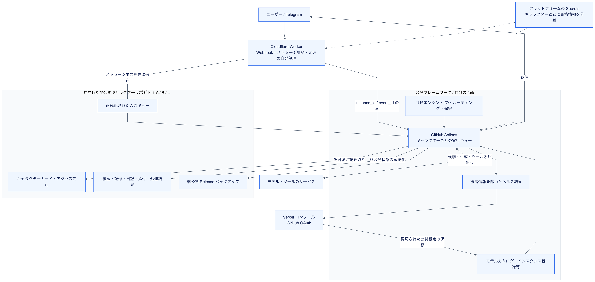
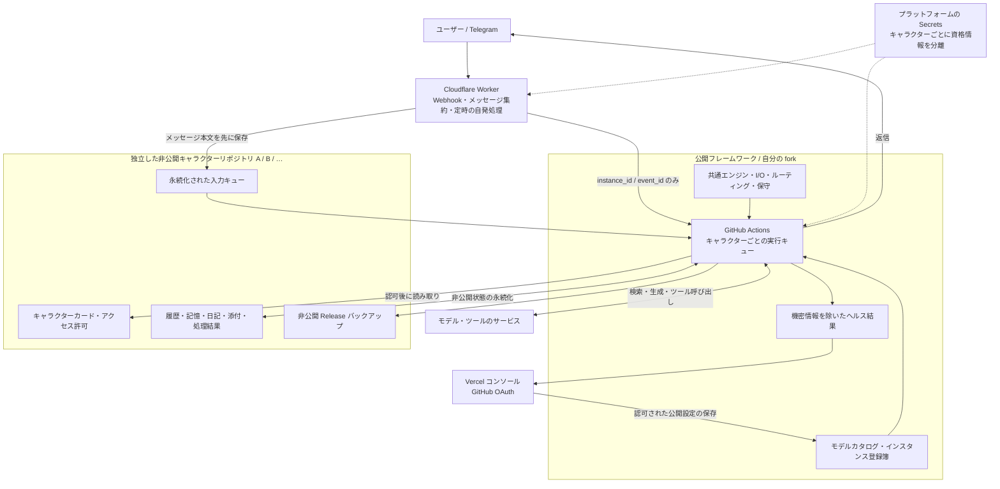
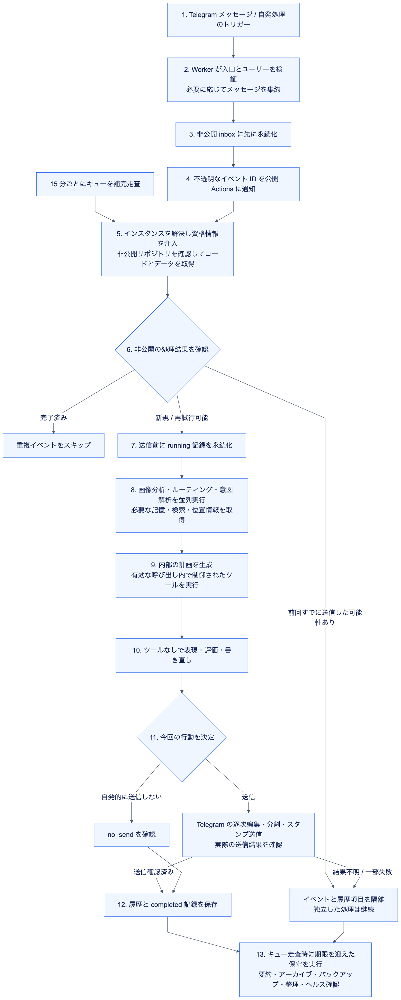
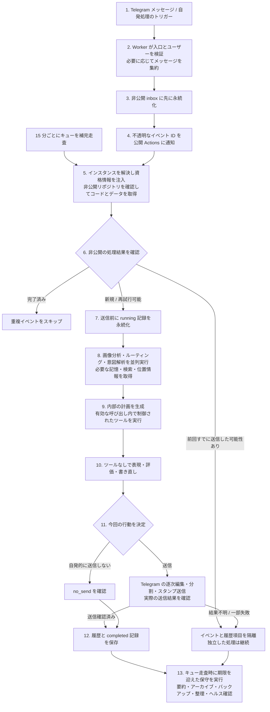

# RP-Core

**ひとつの公開 RP フレームワークと、キャラクターデータだけを保存する複数の非公開リポジトリ。**

[简体中文](README.md) · [English](README.en.md) · [日本語](README.ja.md)

RP-Core は、モデル連携、ルーティング、ツール、記憶、メッセージ送受信、保守処理、ワークフローを公開リポジトリで管理するロールプレイ用フレームワークです。キャラクターカード、個人の会話履歴、日記、データベース、実行状態は、それぞれ独立した非公開リポジトリに保存します。認証情報はデプロイ先の Secrets から注入します。共通コードを更新すると、同じデプロイに属する各キャラクターの次回以降の実行に反映されます。

ライセンスは **AGPL-3.0-only**、現在のパッケージバージョンは **0.3.0** です。天子のカードは新たに書き起こしたサンプルであり、元の利用者の非公開カードや実際の個人的な出来事は含みません。

[モデル設定・ヘルスコンソール](https://rp-core-console.vercel.app) · [完全版ランタイム](docs/full-runtime.md) · [コンソールのデプロイ](docs/console.md) · [レビュー修正記録](docs/review-fixes.md)

## 目次

- [設計とデータの境界](#設計とデータの境界)
- [アーキテクチャと実行フロー](#アーキテクチャと実行フロー)
- [機能と実行モード](#機能と実行モード)
- [オフラインで試す](#オフラインで試す)
- [完全版エンジンをデプロイする](#完全版エンジンをデプロイする)
- [モデル設定と可視化コンソール](#モデル設定と可視化コンソール)
- [キャラクターの追加と更新](#キャラクターの追加と更新)
- [保守とバックアップ、障害復旧](#保守とバックアップ障害復旧)
- [開発と検証](#開発と検証)
- [構成、ドキュメント、ライセンス](#構成ドキュメントライセンス)

## 設計とデータの境界

| 保存先 | 内容 |
| --- | --- |
| 公開 RP-Core または自分の公開 fork | すべての実行コード、組み込み I/O ドライバー、公開モデルカタログ、認証情報を含まない接続先・ルーティング設定、共通プロンプトテンプレート、Worker、コンソール、Actions ワークフロー |
| キャラクターごとの独立した非公開リポジトリ | キャラクターの設定と専用指示、許可ユーザー、会話履歴、日記、知識、関係性の状態、SQLite・ベクトルキャッシュ、添付ファイル、スタンプカタログ、入力キュー、処理結果の記録 |
| GitHub Environment / Cloudflare / Vercel Secrets | モデルの API キー、Telegram token、非公開リポジトリへのアクセス資格情報、OAuth 資格情報、セッション用シークレット |
| 公開 `health/` | 許可された項目だけのヘルス結果、公開モデル ID、時刻、数値統計。上流サービスの生レスポンスやキーは含めない |

非公開リポジトリの `io.json` は、バージョン、データ形式、許可されたファイル対応だけを宣言します。新しいキャラクターに Python アダプター、モデルゲートウェイ、データベース実装、ワークフローをコピーする必要はありません。標準デプロイでは非公開 Python モジュールを import せず、非公開リポジトリの `.env` も読み込みません。

公開コードは実行時に非公開データを読み取るため、管理者は採用するフレームワークのコミット、Actions、実行基盤を信頼する必要があります。リポジトリが非公開であることは、権限を持つ実行環境からデータが見えないことを意味しません。

## アーキテクチャと実行フロー

この README の Mermaid ソースを正とします。ソースの変更後に画像を再生成し、画像だけを直接編集しないでください。

### アーキテクチャ図



<details>
<summary>Mermaid ソース（編集の基準）</summary>

<!-- rp-diagram: architecture.ja -->


</details>

非公開リポジトリは runner に一時的に checkout されます。メッセージ本文、データベース、実行ログを公開 Actions artifact として配布しません。完全版エンジンのバックアップは、対象が非公開であると確認したキャラクターリポジトリの Release にだけアップロードします。

### メッセージが処理される手順



<details>
<summary>Mermaid ソース（編集の基準）</summary>

<!-- rp-diagram: execution.ja -->


</details>

この図は完全版エンジンの主な処理境界を示します。個別の分岐は公開設定で決まります。`replied_flag`、空でない返信文、生成の成功だけでは Telegram への送達を証明できません。送信結果が不明なイベントは隔離し、独立した処理を続けたうえで、ワークフローを非ゼロ終了にして問題を報告します。送信前の記録を永続化できなければ、その時点で停止します。

## 機能と実行モード

### 完全版エンジン

`config/runtime/full.json` は公開の互換ランタイムを使用し、既存 Tenshi の機能とデータ配置に対応します。

- Claude、GPT、Gemini、Grok、DeepSeek、GLM などのモデル連携、OpenRouter・MagmaRouter・プロキシ経路とフェイルオーバー。対応済みの一部経路では Responses を利用します。
- 内部の計画と外向きの表現を分けた二段階返信、自発的な無送信、逐次編集、分割返信、スタンプ、リアクション。評価と書き直しでは書き込みツールを実行できません。
- 画像・文書・音声などの添付処理、アルバムの集約、引用メッセージ、Web 検索、天気、位置の文脈。実際に使える機能はモデルとサービス設定によります。
- SQLite、FTS、FAISS、Qwen embedding、同一プロセス内での同一 embedding リクエストの集約、バッチキャッシュ。
- 日記、分割された知識データ、要約、文脈圧縮、関係性の証拠と振り返り、遅延された意図、ランダム・定時の自発処理。
- Git 永続化、staging からの復旧、処理結果の隔離、ログローテーション、参照中の添付の保護、非公開バックアップ。

**完全版エンジンは、ひとつの非公開データリポジトリにつき一人のユーザーと、その人の Telegram 個人チャットに対応します。** 複数ユーザーや別の chat 宛ての設定は明示的に拒否します。複数キャラクターは別々のリポジトリと登録済みインスタンスで運用します。

### 設定の選択

| 設定 | エンジンと入力経路 | 用途 |
| --- | --- | --- |
| `config/runtime/full.json` | 完全版。通常は `full.mjs` から非公開 inbox に入力 | 完全な機能と既存データの再利用 |
| `config/runtime/offline.json` | 軽量な native エンジン。固定スクリプト、ファイル出力、ローカル保存 | API・Telegram を使わない体験 |
| `config/runtime/default.json` | 軽量な native エンジン。Telegram ポーリング | 小規模なテキスト RP |
| `config/runtime/webhook.json` | 軽量な native エンジン。ポーリングを無効にしてキューから入力 | `telegram.mjs` を使う軽量入口 |

`io.json` の `driver` はデータ形式を、実行設定はエンジンを選択します。完全版は標準の `tenshi-v1` 配置を必要とし、独自の `session_map` や任意のパス置換を受け付けません。native エンジンでは対応するマッピング機能を引き続き利用できます。

## オフラインで試す

Git、Python **3.11 以上**、`uv` が必要です。コンソールの開発には Node.js **22.x** も必要です。

```bash
git clone https://github.com/Hisou-Tenshi/RP-Core.git
cd RP-Core
uv sync --locked --extra dev
uv run --no-sync rp-core init-instance --path instance --demo-event
uv run --no-sync rp-core run --config config/runtime/offline.json --data-root instance
```

新たに書き起こした短い天子カード、架空のメッセージ、固定スクリプトの出力を使用します。実際のモデル呼び出しや Telegram 送信はありません。出力は `instance/state/outbox.jsonl` に保存され、同じイベントを再実行しても返信を重複生成しません。この例は native エンジンのデータ境界と冪等性を示すもので、完全版の全機能を検証するものではありません。

## 完全版エンジンをデプロイする

自分の公開 fork と非公開キャラクターリポジトリを構築する手順です。既存の天子環境を再初期化する必要はありません。

### 1. Fork と非公開データの準備

公開リポジトリを fork し、必要な Actions ワークフローを有効にします。`YOUR_ACCOUNT/tenshi-data` のような独立した非公開リポジトリを作り、フレームワークの隣に clone します。フレームワークのディレクトリで実行してください。

```bash
uv sync --locked --extra dev --extra full
uv run --no-sync rp-core init-instance --path ../tenshi-data --driver tenshi-v1
```

非公開リポジトリの `character.json` と `identity.json` を編集します。最小カードの例は次のとおりです。本番用キャラクターの専用指示は非公開リポジトリだけに記載してください。

```json
{
  "id": "tenshi-example",
  "name": "天子",
  "instructions": "新たに書き起こした天子のサンプルです。自然に会話し、ユーザーと過去に個人的な体験を共有したと決めつけないでください。"
}
```

次の数値を自分の Telegram ユーザー ID に置き換え、このファイルを非公開リポジトリに保存します。

```json
{
  "allowed_user_ids": [123456789],
  "telegram": {
    "chat_id": 123456789,
    "allowed_chat_ids": [123456789]
  }
}
```

許可リストが空の場合、メッセージを受け付けません。I/O の準備と確認には次を使用します。

```bash
uv run --no-sync rp-core full --task prepare --data-root ../tenshi-data
uv run --no-sync rp-core full --task preflight --data-root ../tenshi-data
```

データを非公開リポジトリの `main` に commit します。`prepare` は既存データベースの再構築や既存カードの上書きを行いません。I/O を初期化済みのディレクトリに `init-instance` を再実行しないでください。

### 2. インスタンス登録と GitHub Environment

初期インスタンスは `config/instances.json` に登録されています。

```json
{
  "schema_version": 1,
  "instances": [
    {
      "id": "tenshi",
      "repository_variable": "RP_TENSHI_REPOSITORY",
      "environment": "tenshi",
      "runtime": "config/runtime/full.json"
    }
  ]
}
```

自分の公開 fork に設定します。

| 種類 | 名前 | 値・用途 |
| --- | --- | --- |
| Repository Variable | `RP_TENSHI_REPOSITORY` | `YOUR_ACCOUNT/tenshi-data`。設定済みインスタンスの選択に使用 |
| Repository Variable | `RP_LIVE_ENABLED` | 準備完了後に `true`。本番のキャラクターワークフローを有効化 |
| GitHub Environment | `tenshi` | 登録簿の名前と一致させ、キャラクターごとに資格情報を分離 |
| Environment Secret | `RP_INSTANCE_TOKEN` | 対象の非公開データリポジトリに対する Contents 読み書き権限。非公開 Release バックアップにも使用 |
| Environment Secret | `RP_TELEGRAM_TOKEN` | キャラクターの Bot token。旧 `TG_TOKEN` にも対応 |
| Environment Secret | `OPENROUTER_API_KEY` / `RP_MODEL_API_KEY` | OpenRouter 接続。後者は互換用の別名 |
| Environment Secret | `QWEN_API_KEY` | Qwen embedding を使う記憶の検索・書き込み |
| Environment Secrets | 各サービス・プロキシのキー | 実際に有効にする経路だけ設定。全サービスのキーは不要 |
| Environment Secret | `PERCEPTION_SCHEDULE_SYNC_URL` | Worker の `/internal/perception-schedule` エンドポイント |
| Environment Secret | `PERCEPTION_SCHEDULE_SYNC_SECRET` | Worker と同じスケジュール同期用シークレット |

完全版の Telegram 入力は Worker・非公開 inbox 経由です。`full.json` 自体は Telegram をポーリングしません。新着メッセージがなくても、キュー走査時に期限を迎えた保守処理を実行できます。利用可能なモデルサービス、プロキシ設定、Secret 名は公開設定とワークフローで決まります。キーがない経路を自動で利用できるわけではありません。

### 3. Cloudflare 入口のデプロイ

`integrations/cloudflare/full.mjs` と依存モジュールをデプロイします。Dashboard に単一ファイルを貼り付ける場合は、次で生成します。

```bash
node scripts/build_cloudflare.mjs
```

生成された `integrations/cloudflare/dashboard-worker.mjs` を配置します。`KV` という名前で KV namespace をバインドし、次を設定してください。

| 種類 | 名前 | 説明 |
| --- | --- | --- |
| 通常の変数 | `DATA_REPOSITORY` | 自分の非公開データリポジトリ |
| 通常の変数 | `DATA_BRANCH` | `main` |
| 通常の変数 | `PUBLIC_REPOSITORY` | 自分の公開 fork |
| 通常の変数 | `INSTANCE_ID` | `tenshi` などの登録済み ID |
| 通常の変数 | `RP_LIVE_ENABLED` | 接続準備の完了後に文字列 `true` |
| Secret | `DATA_TOKEN` | 非公開データリポジトリの Contents 読み書き権限 |
| Secret | `DISPATCH_TOKEN` | 公開 fork に `repository_dispatch` を送る権限 |
| Secret | `TELEGRAM_WEBHOOK_SECRET` | Telegram `setWebhook` の `secret_token` と一致させる |
| Secret | `PERCEPTION_SCHEDULE_SYNC_SECRET` | GitHub 側と同じ同期用シークレット |

Bot の webhook を自分の Worker に向け、対応する `secret_token` を設定します。分単位の自発処理が必要なら、別途 Worker に Cron Trigger を設定してください。たとえば毎分一回です。ランダム・指定時刻の自発処理は、GitHub の 15 分ごとの補完走査だけで実現するものではありません。

Worker は非公開イベントを保存してから、公開側に ID を通知します。日程の消費確認は個別の KV キーに保存し、同時に行われる日程同期を上書きしません。`GET /health` で簡単な状態を確認でき、制御用エンドポイントには同期シークレットによる認証が必要です。

### 4. 有効化と確認

同じキャラクターの旧実行経路を停止し、GitHub と Worker の両方で `RP_LIVE_ENABLED=true` にします。その後 **Run private characters** を確認してください。手動実行では `instance_id=tenshi` または `all` を指定でき、webhook からのイベント通知でも起動します。ワークフローには 15 分ごとの永続キュー走査も設定されていますが、定時実行はリアルタイム性の保証ではありません。

token、メッセージ本文、キャラクターデータを公開ワークフローの入力に記載しないでください。自分の Secrets を使用します。runner、モデル API、Cloudflare、Vercel の料金や制限は各サービスが別々に定めており、本プロジェクトは恒久的な無料運用を保証しません。

## モデル設定と可視化コンソール

完全版エンジンの公開モデルカタログは、次のファイルに集約されています。

```text
src/rp_core/compat_runtime/model-config.json
```

モデル ID、サービス、階層、順序、OpenRouter 対応、対話・要約チェーン、embedding 設定、公開編集を許可する接続・推論パラメーターを管理します。native エンジンの `config/runtime/default.json` とは別の設定です。

`web/` のコンソールでは、インスタンス別の機密情報を除いたヘルス結果を表示し、GitHub OAuth で公開モデル設定を保存できます。モデル名を変更するとルーティング内の参照も維持します。追加欄は初期状態が空で、候補を選択してから明示的に追加ボタンを押す必要があります。

自分のコンソールをデプロイする手順：

1. 公開 fork を Vercel に import し、Root Directory を `web`、Node.js を `22.x`、インストールを `npm ci`、ビルドを `npm run build`、出力先を `public` に設定します。
2. `web/.env.example` に従い、`RP_PUBLIC_REPOSITORY`、`RP_PUBLIC_BRANCH`、`RP_APP_ORIGIN`、数値の GitHub 管理者 ID リスト `RP_ADMIN_IDS` を設定します。
3. 自分の GitHub OAuth App を作り、callback を `https://YOUR_DOMAIN/api/auth/callback/github` にします。Vercel に `GITHUB_CLIENT_ID`、`GITHUB_CLIENT_SECRET`、ランダムな `AUTH_SECRET` を保存します。
4. 許可リストに含まれ、設定した公開リポジトリへの push 権限を現在も持つアカウントでログインして保存します。

OAuth は `read:user public_repo` を要求します。サーバーは書き込み先を設定済みの公開リポジトリに制限し、非公開リポジトリへのアクセス権限を要求しません。モデルキー、キャラクターカード、会話履歴も読み取りません。保存時は Git blob SHA で競合を検出します。保存後の新しいジョブには新設定が適用され、実行中のジョブは checkout 済みのコミットを使い続けます。

**RP provider health** は定時、手動、モデルカタログ変更時に実行されます。各インスタンスに対応する Environment のキーを使用し、`health/<instance>/latest.json` と `history.json` を公開します。チェックでは生成を行いません。緑の結果でも、生成・ストリーミング・ツール利用の成功までは保証しません。

**embedding のモデルや次元を変更しても、既存ベクトルは自動移行されません。** 非互換な変更には別途データ・インデックス移行の計画が必要です。SDK やプロトコルの新しい種類を追加する場合も、公開コードの修正が必要です。詳細は [コンソールの説明](docs/console.md) を参照してください。

## キャラクターの追加と更新

別の非公開データリポジトリ、identity、`io.json` を作り、公開登録簿に項目を追加します。対応する Repository Variable、Environment、必要な Worker バインディングと webhook を設定します。共通ワークフローが行列形式で各インスタンスを実行するため、キャラクターごとの実行コードの複製は不要です。

同じ公開デプロイに属するキャラクターには、次回以降のジョブで共通更新が反映されます。他の利用者の fork は上流との同期が必要です。キャラクター専用の内容は非公開データで変更し、ロジックの問題は公開リポジトリで修正します。機密でない差分は公開設定で表現できますが、完全版のモデルカタログは現在ひとつの公開 JSON を共有します。

既存 Tenshi の JSON、SQLite、FTS、ベクトル、日記はそのまま保持できます。完全版は一時的な実行ビューで公開コードと非公開データを組み合わせます。`prepare` は旧 persona からリテラルを抽出するだけで、非公開ソースを実行しません。[完全版ランタイム](docs/full-runtime.md) と [移行の背景](docs/tenshi-migration.md) を参照してください。

## 保守とバックアップ、障害復旧

| 既定の保守処理 | 間隔 | 結果 |
| --- | --- | --- |
| 要約 | 3 時間 | 非公開の知識・記憶・関係性などの状態を更新 |
| 履歴アーカイブ | 7 日 | 既存形式で過去の履歴を分割保存 |
| 日次バックアップ | 24 時間 | 非公開リポジトリの Release。日次 7 世代を保持 |
| 週次バックアップ | 7 日 | 非公開リポジトリの Release。週次 4 世代を保持 |
| 整理 | 24 時間 | 会話フィールドの整理、ログ圧縮・ローテーション、未参照の古い添付の削除 |
| 非公開の診断チェック | 24 時間 | 完全版の診断。公開ダッシュボードには別ワークフローを使用 |

特定の `event_id` を指定しないキュー走査で、実行期限を確認します。正確な時刻の実行は保証しません。ログの機密情報を除去した後、10 MiB 以上の稼働ログをローテーションします。日次整理では残りのログも対象にし、最新の三つのアーカイブ日を保持します。添付ファイルは最低三日間保持し、現在・アーカイブの JSON が参照しているファイルは削除しません。参照データを読み取れなければ削除を中止します。

バックアップは対象リポジトリの非公開設定を確認してから ZIP をアップロードします。SQLite には整合性のあるスナップショット API を使用し、公開 artifact として配布しません。手動実行は `rp-core full --task daily-backup` または `weekly-backup` に、非公開の `--data-root`、対応する資格情報、明示的な `RP_ALLOW_LIVE=1` を指定します。

復旧時の原則：

- 完了を確認済みのイベントはスキップします。Telegram に届いた可能性があるイベントは隔離し、確認なしに再実行しません。
- 送信前の失敗と判定できる返信、および安全に再試行できる保守イベントには、既定で最大三回のキュー再試行上限を設けます。
- 非公開の `.rp/full-receipts/`、履歴、Telegram を照合してから、対応する処理結果と `rp_delivery_quarantined` マーカーを手動で修正します。再試行回数の上限に達した場合は明示的なリセットも必要です。
- 非公開 main への永続化に失敗したら `bot-staging/*` の復旧ブランチへの保存を試み、追加の送信を止めます。次回ジョブでは staging を先に取り込みます。force push やデータベース再構築で競合を隠さないでください。
- キャンセルは期限切れ処理による新たなリクエスト、コールバック、ツール動作を防ぎます。開始済みのネットワーク I/O や書き込みを遡って取り消すことはできず、プロセスグループの強制タイムアウトを最後の境界として残します。

## 開発と検証

```bash
uv sync --locked --extra dev --extra full
uv run --no-sync pytest
uv run --no-sync python scripts/run_compat_tests.py
node --test tests/test_cloudflare*.mjs
uv run --no-sync ruff check .
uv run --no-sync ruff format --check .
uv run --no-sync python scripts/export_schemas.py --check
uv run --no-sync python scripts/audit_public.py
uv run --no-sync python scripts/review_runtime_manifest.py --check
node scripts/build_cloudflare.mjs --check
uv run --no-sync python -m build --no-isolation
```

コンソール：

```bash
cd web
npm ci
npm test
npm run build
```

テストには合成データ、mock、一時データベース、ローカル Git remote を使用します。互換テストは現在の編集可能なモデルカタログを検証した後、隔離環境の固定された過去のカタログで旧回帰テストを実行します。過去のモデル名のハードコードによって、正当なコンソール上の改名が拒否されることを防ぎます。

`rp-core full --task shadow` は、既定ではオフラインの `selfcheck` を行います。`--shadow-task probe` を明示すると実際のサービスにアクセスします。`--shadow-task reply` は実際のモデルで合成返信を生成し、料金が発生する可能性がありますが、Telegram 送信は影のトランスポートに置換されます。shadow の成功やテストの通過は、本番の全機能・負荷試験を完了したことを意味しません。

README の画像は各言語の折りたたみ内のソースから生成します。生成手順とブラウザー設定は [図の保守手順](docs/diagrams/README.md) を参照してください。

```bash
npm ci --prefix docs/diagrams
npm run build --prefix docs/diagrams
npm run check --prefix docs/diagrams
```

## 構成、ドキュメント、ライセンス

```text
src/rp_core/                  公開ホスト・プロトコル・I/O・実行ロジック
src/rp_core/compat_runtime/   完全版エンジン・公開モデルカタログ・出典一覧
config/                      インスタンス登録簿・実行設定
integrations/cloudflare/     完全版・軽量入口と Dashboard 用バンドル
web/                         Vercel の OAuth モデルコンソール
health/                      公開を許可されたヘルス結果
schemas/                     バージョン管理された JSON Schema
scripts/                     ビルド・検証・ヘルス確認・レビュー用ツール
tests/                       フレームワーク・入力経路の回帰テスト
validation/                  合成の互換テスト・過去の固定 fixture
docs/                        アーキテクチャ・接続・インターフェース・復旧
```

| ドキュメント | 内容 |
| --- | --- |
| [完全版ランタイム](docs/full-runtime.md) | 完全な機能、旧配置、本番接続、切り替え |
| [コンソール](docs/console.md) | OAuth、公開カタログ、ヘルス確認、Vercel 設定 |
| [データインターフェース](docs/private-adapter.md) | 宣言型の非公開データ I/O。一部は native エンジン向け |
| [native エンジンのデプロイ](docs/deploy.md) | 軽量ポーリングと webhook の構成 |
| [rp/1 プロトコル](docs/protocol-v1.md) | 処理の調整と任意の標準入出力拡張 |
| [互換性](docs/compatibility.md) | データ・プロトコルの互換方針 |
| [セキュリティ境界](docs/security-and-review.md) | 公開・非公開の境界と信頼モデル |
| [レビュー修正](docs/review-fixes.md) | R1–R10 の修正、性能改善、検証範囲 |

本リポジトリのすべてのプロジェクトコード、ドキュメント、独自サンプル、生成物には [AGPL-3.0-only](LICENSE) を統一して適用します。同じ著作権者がこのライセンスでの公開を許諾した Tenshi 由来のコードも含み、別の寛容なライセンスによる例外は設けません。出典と著作権表示は [NOTICE](NOTICE)、独自のライセンスを保持する外部パッケージについては [依存関係のライセンス境界](THIRD_PARTY_LICENSES.md) を参照してください。公開サンプルには、元プロジェクトの非公開会話、データベース、資格情報、スタンプ素材を含めません。
