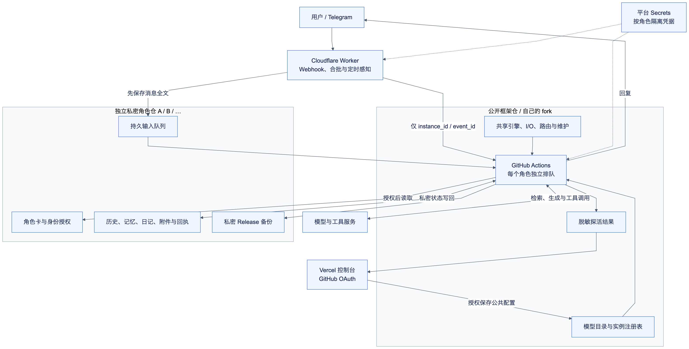
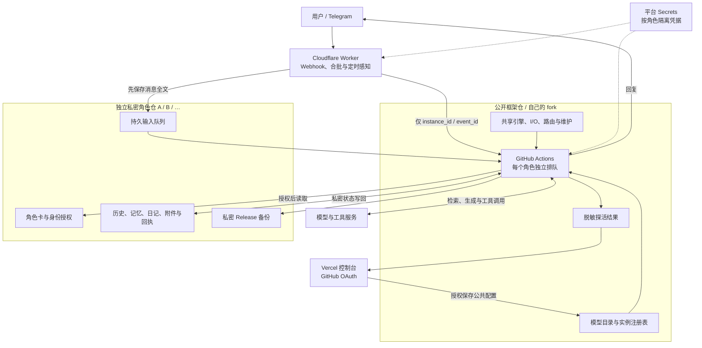
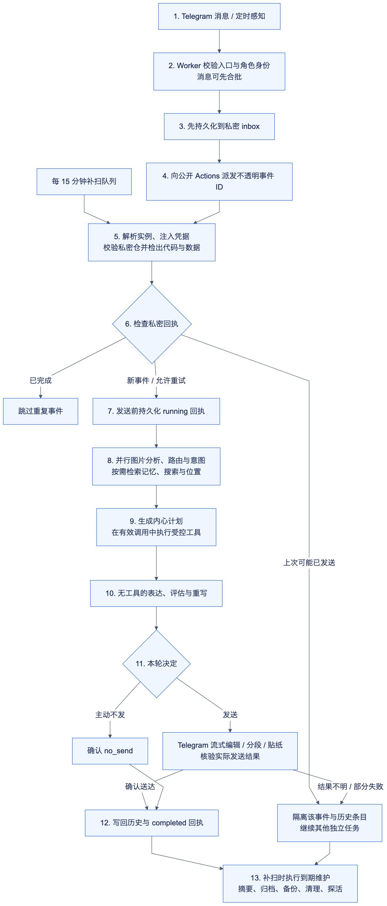
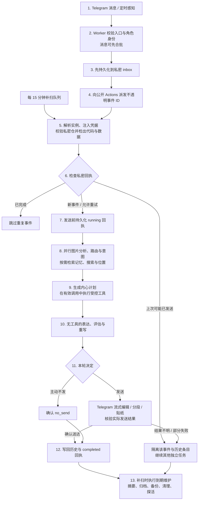

# RP-Core

**一个公开 RP 框架，多个只保存数据的私密角色仓。**

[简体中文](README.md) · [English](README.en.md) · [日本語](README.ja.md)

RP-Core 将角色扮演机器人的模型接入、路由、工具、记忆、消息收发、维护和工作流集中在公开仓库。角色卡、个人历史、日记、数据库和运行状态保存在独立私密仓库；密钥通过部署平台的 Secrets 注入。修复一份公开代码，同一部署下的所有角色都能在后续运行中使用更新后的逻辑。

项目采用 **AGPL-3.0-only**，当前包版本为 **0.3.0**。天子是独立编写的示例角色，不包含原使用者的私密角色卡或真实经历。

[模型与探活控制台](https://rp-core-console.vercel.app) · [完整运行时](docs/full-runtime.md) · [控制台部署](docs/console.md) · [审查修复记录](docs/review-fixes.md)

## 目录

- [设计与数据边界](#设计与数据边界)
- [架构与运行流程](#架构与运行流程)
- [能力与运行模式](#能力与运行模式)
- [离线快速体验](#离线快速体验)
- [部署完整引擎](#部署完整引擎)
- [模型配置与可视化控制台](#模型配置与可视化控制台)
- [增加角色与升级](#增加角色与升级)
- [维护、备份与失败恢复](#维护备份与失败恢复)
- [开发与验证](#开发与验证)
- [目录、文档与许可证](#目录文档与许可证)

## 设计与数据边界

| 位置 | 保存内容 |
| --- | --- |
| 公开 RP-Core 或自己的公开 fork | 全部执行代码、内置 I/O 驱动、模型目录、端点和路由等非私密设置、通用提示词模板、Worker、网页控制台、Actions 工作流 |
| 每个角色的独立私密仓 | 角色身份与专属指令、授权用户、历史、日记、知识、关系状态、SQLite/向量缓存、附件、贴纸目录、输入队列与执行回执 |
| GitHub Environment / Cloudflare / Vercel Secrets | 模型 key、Telegram token、数据仓访问令牌、OAuth 凭据与会话密钥 |
| 公开 `health/` | 按白名单发布的探活状态、公开模型标识、时间和数值统计，不含原始响应或密钥 |

私密仓的 `io.json` 只声明版本、数据格式与允许的文件绑定。新角色不需要复制 Python 适配器、模型网关、数据库实现或工作流。标准部署不会导入私密 Python 模块，也不会加载私密仓的 `.env`。

公开代码运行时需要读取私密数据，因此仓主仍需信任所选框架提交、Actions 和执行平台。数据仓的私密可见性不等于执行环境不可见数据。

## 架构与运行流程

图以本 README 中的 Mermaid 源码为准；修改后重新生成图片，勿单独编辑图片。

### 架构图



<details>
<summary>Mermaid 源码（修改依据）</summary>

<!-- rp-diagram: architecture.zh -->


</details>

私密仓会临时检出到运行器；消息正文、数据库和运行日志不作为公开 Actions artifact 发布。完整模式的备份只上传到经过私密性校验的角色仓 Release。

### 一条消息如何运行



<details>
<summary>Mermaid 源码（修改依据）</summary>

<!-- rp-diagram: execution.zh -->


</details>

流程图描述完整引擎的主要边界，具体分支由公开配置决定。`replied_flag`、非空回复文本或成功生成，都不能单独证明 Telegram 已送达。发送不明确时会隔离，独立任务继续处理，工作流最终以非零状态报告问题。发送前的持久化失败则立即停止，不继续发送。

## 能力与运行模式

### 完整引擎

`config/runtime/full.json` 使用公开的兼容运行时，面向既有 Tenshi 功能与数据布局：

- Claude、GPT、Gemini、Grok、DeepSeek、GLM 等模型接入，以及 OpenRouter / MagmaRouter / 代理通路与故障切换；已适配的部分通路支持 Responses。
- 内心计划与对外表达两阶段回复、主动不发、流式编辑、分段、贴纸及表情回应；评估与重写不开放写工具。
- 图片、文档、音频等附件处理、相册合批、引用消息、网页搜索、天气与位置上下文；实际能力取决于模型和服务配置。
- SQLite、FTS、FAISS、Qwen embedding、进程内相同请求合并及批处理缓存。
- 日记、知识分片、摘要、上下文压缩、关系证据与反思、延迟意图，以及随机/定时感知。
- Git 持久化与 staging 恢复、回执隔离、日志轮转、附件引用保护及私密备份。

**完整引擎每个私密数据仓仅支持一个用户及其私人 Telegram 对话。** 多用户或不同 chat 的配置会明确报错。多角色通过多个数据仓和实例运行。

### 选择配置

| 配置 | 引擎与入口 | 用途 |
| --- | --- | --- |
| `config/runtime/full.json` | 完整引擎；处理私密 inbox，通常由 `full.mjs` 接入 | 完整功能与旧数据复用 |
| `config/runtime/offline.json` | 精简原生引擎；脚本模型、文件输出、本地持久化 | 无 API、无 Telegram 的离线体验 |
| `config/runtime/default.json` | 精简原生引擎；Telegram 轮询 | 较小的文本 RP 部署 |
| `config/runtime/webhook.json` | 精简原生引擎；关闭轮询，接收队列事件 | 搭配 `telegram.mjs` 的轻量入口 |

`io.json` 的 `driver` 决定数据格式，运行配置决定引擎。完整引擎要求标准 `tenshi-v1` 布局，不接受自定义 `session_map` 或任意路径替换；原生引擎保留相应映射能力。

## 离线快速体验

需要 Git、Python **3.11+** 和 `uv`。控制台开发另需 Node.js **22.x**。

```bash
git clone https://github.com/Hisou-Tenshi/RP-Core.git
cd RP-Core
uv sync --locked --extra dev
uv run --no-sync rp-core init-instance --path instance --demo-event
uv run --no-sync rp-core run --config config/runtime/offline.json --data-root instance
```

示例使用重新编写的简短天子角色卡、虚构消息和固定脚本输出，不调用真实模型，也不发送 Telegram。输出位于 `instance/state/outbox.jsonl`；再次运行同一事件不会重复生成。这里演示原生引擎的数据边界和幂等机制，不代表已测试所有完整引擎功能。

## 部署完整引擎

以下路径供你部署自己的公开 fork 和私密角色仓。现有天子部署不需要按此重新初始化。

### 1. Fork 并准备私密数据

Fork 公开仓并启用需要的 Actions 工作流。创建独立私密仓，例如 `YOUR_ACCOUNT/tenshi-data`，clone 到框架旁边，然后从框架目录运行：

```bash
uv sync --locked --extra dev --extra full
uv run --no-sync rp-core init-instance --path ../tenshi-data --driver tenshi-v1
```

在私密仓编辑 `character.json` 和 `identity.json`。角色卡最小结构如下；生产角色的专属指令只填写在私密仓：

```json
{
  "id": "tenshi-example",
  "name": "天子",
  "instructions": "这是独立编写的天子示例。自然交流，不假设与用户已有私人经历。"
}
```

将下面的示例数字替换为你自己的 Telegram 用户 ID，保留在私密仓：

```json
{
  "allowed_user_ids": [123456789],
  "telegram": {
    "chat_id": 123456789,
    "allowed_chat_ids": [123456789]
  }
}
```

空授权列表不会接收消息。可以检查和准备已有 I/O：

```bash
uv run --no-sync rp-core full --task prepare --data-root ../tenshi-data
uv run --no-sync rp-core full --task preflight --data-root ../tenshi-data
```

将数据提交到私密仓 `main`。`prepare` 不重建已有数据库，也不覆盖已有角色卡；不要对已有 I/O 的目录重复运行 `init-instance`。

### 2. 注册实例并配置 GitHub Environment

默认实例注册在 `config/instances.json`：

```json
{
  "schema_version": 1,
  "instances": [
    {
      "id": "tenshi",
      "repository_variable": "RP_TENSHI_REPOSITORY",
      "environment": "tenshi",
      "runtime": "config/runtime/full.json"
    }
  ]
}
```

在公开 fork 配置：

| 类型 | 名称 | 值或用途 |
| --- | --- | --- |
| Repository Variable | `RP_TENSHI_REPOSITORY` | `YOUR_ACCOUNT/tenshi-data`；计划任务用它筛选实例 |
| Repository Variable | `RP_LIVE_ENABLED` | 准备完成后设为 `true`；启用正式角色工作流 |
| GitHub Environment | `tenshi` | 与注册表名称一致；按角色隔离凭据 |
| Environment Secret | `RP_INSTANCE_TOKEN` | 所选私密数据仓的 Contents 读写权限，包括私密 Release 备份 |
| Environment Secret | `RP_TELEGRAM_TOKEN` | 该角色 Bot 的 token；兼容旧 `TG_TOKEN` |
| Environment Secret | `OPENROUTER_API_KEY` / `RP_MODEL_API_KEY` | OpenRouter 通路；后者作为兼容别名 |
| Environment Secret | `QWEN_API_KEY` | 使用 Qwen embedding 的记忆检索/写入 |
| Environment Secrets | 对应供应商和代理 key | 按实际启用的公开通路配置；不需要填写所有厂商 |
| Environment Secret | `PERCEPTION_SCHEDULE_SYNC_URL` | Worker 的 `/internal/perception-schedule` 地址 |
| Environment Secret | `PERCEPTION_SCHEDULE_SYNC_SECRET` | 与 Worker 使用相同的定时同步密钥 |

完整引擎的 Telegram 收件来自 Worker/私密 inbox，`full.json` 本身不轮询 Telegram。没有消息的队列运行仍可执行到期维护。可用供应商、代理参数和 Secret 槽位以公开配置及工作流为准；缺失 key 的通路不会凭空获得调用能力。

### 3. 部署 Cloudflare 入口

使用 `integrations/cloudflare/full.mjs` 及其依赖模块。若通过 Dashboard 粘贴单文件：

```bash
node scripts/build_cloudflare.mjs
```

部署生成的 `integrations/cloudflare/dashboard-worker.mjs`。绑定名为 `KV` 的命名空间，并配置：

| 类型 | 名称 | 说明 |
| --- | --- | --- |
| 普通变量 | `DATA_REPOSITORY` | 自己的私密数据仓 |
| 普通变量 | `DATA_BRANCH` | `main` |
| 普通变量 | `PUBLIC_REPOSITORY` | 自己的公开 fork |
| 普通变量 | `INSTANCE_ID` | 例如 `tenshi`，必须已注册 |
| 普通变量 | `RP_LIVE_ENABLED` | 完成接入后设为字符串 `true` |
| Secret | `DATA_TOKEN` | 私密数据仓 Contents 读写权限 |
| Secret | `DISPATCH_TOKEN` | 向公开 fork 发送 `repository_dispatch` 的权限 |
| Secret | `TELEGRAM_WEBHOOK_SECRET` | 与 Telegram `setWebhook` 的 `secret_token` 一致 |
| Secret | `PERCEPTION_SCHEDULE_SYNC_SECRET` | 与 GitHub 中的同名同步密钥一致 |

将 Bot webhook 指向自己的 Worker，并设置匹配的 `secret_token`。需要分钟级感知时，另在 Worker 配置 Cron Trigger，例如每分钟一次；随机和指定时间的感知不是 GitHub 15 分钟补扫本身提供的。

Worker 先存私密事件，再派发公开事件。定时日程用独立 KV 消费确认，避免消费时覆盖新的日程同步。`GET /health` 提供简要状态；控制接口需要同步密钥认证。

### 4. 启用并检查

停止同一角色的旧执行入口，设置 GitHub 与 Worker 两处 `RP_LIVE_ENABLED=true`，然后检查 **Run private characters**。可以手动选择 `instance_id=tenshi` 或 `all`，或由 webhook 派发事件。工作流还配置了每 15 分钟补扫一次持久队列；调度不是实时服务保证。

令牌、消息正文和角色数据不得填进公开工作流输入。使用自己的 Secrets；运行器费用、模型 API、Cloudflare 和 Vercel 的用量与限制分别由相应服务决定，本项目不承诺永久免费。

## 模型配置与可视化控制台

完整引擎的单一公开模型目录是：

```text
src/rp_core/compat_runtime/model-config.json
```

它维护模型 ID、厂商、档位、顺序、OpenRouter 映射、对话与摘要链、embedding 设置，以及允许公开编辑的连接/推理参数。它与原生引擎的 `config/runtime/default.json` 是不同配置。

控制台位于 `web/`，支持查看各实例的脱敏探活结果，以及通过 GitHub OAuth 保存公开模型配置。模型改名会维护路由引用；添加栏默认置空，选择候选后需明确点击添加。

部署自己的控制台：

1. 在 Vercel 导入自己的公开 fork，Root Directory 设为 `web`，Node.js 为 `22.x`，安装 `npm ci`、构建 `npm run build`、输出目录 `public`。
2. 按 `web/.env.example` 设置 `RP_PUBLIC_REPOSITORY`、`RP_PUBLIC_BRANCH`、`RP_APP_ORIGIN` 与数字 GitHub 管理员 ID 列表 `RP_ADMIN_IDS`。
3. 创建自己的 GitHub OAuth App，回调为 `https://YOUR_DOMAIN/api/auth/callback/github`；在 Vercel 保存 `GITHUB_CLIENT_ID`、`GITHUB_CLIENT_SECRET` 与随机 `AUTH_SECRET`。
4. 由在允许列表内、且对目标公开仓仍有 push 权限的账号登录保存。

OAuth 申请 `read:user public_repo`；服务端将写入限制在配置的公开仓，不申请私密仓访问，也不读取模型 key、角色卡或聊天历史。保存使用 Git blob SHA 做冲突检查。控制台提交后的新任务使用新配置，已在运行的任务继续使用其检出的提交。

探活由 **RP provider health** 工作流定期、手动或在模型目录变化后运行，读取各实例对应 Environment 的 key，发布 `health/<instance>/latest.json` 和 `history.json`。探活使用非生成检查；状态为绿不保证生成、流式和工具调用一定成功。

**修改 embedding 模型或维度不会自动迁移已有向量。** 这类变更必须单独规划数据/索引迁移。新增 SDK 或协议家族也仍需修改公开代码。详细配置见 [控制台说明](docs/console.md)。

## 增加角色与升级

新增角色只需另建私密数据仓、身份和 `io.json`，然后在公开注册表添加条目，建立对应 Repository Variable、Environment，以及该角色需要的 Worker 绑定和 webhook。共享工作流通过矩阵执行，不需要复制每个角色的执行代码。

同一公开部署中的角色在后续任务使用共享框架更新；其他人的 fork 需要同步上游。角色专属内容只改私密数据，逻辑问题在公开仓修复。非私密差异可以用公开配置区分，完整引擎的模型目录目前由同一份公共 JSON 管理。

已有 Tenshi 数据可保留原 JSON、SQLite、FTS、向量和日记，完整引擎通过临时视图组合公开代码与私密数据。`prepare` 对旧 persona 仅抽取字面量，不执行私密源码。接入说明见 [完整运行时](docs/full-runtime.md) 和 [迁移背景](docs/tenshi-migration.md)。

## 维护、备份与失败恢复

| 默认维护 | 间隔 | 结果 |
| --- | --- | --- |
| 摘要 | 3 小时 | 更新知识、记忆与关系等私密状态 |
| 历史归档 | 7 天 | 按旧格式归档历史切片 |
| 每日备份 | 24 小时 | 私密仓 Release，保留 7 个每日备份 |
| 每周备份 | 7 天 | 私密仓 Release，保留 4 个每周备份 |
| 清理 | 24 小时 | 整理聊天字段、压缩轮转日志、清理未引用旧附件 |
| 私密诊断探活 | 24 小时 | 完整运行时的私密诊断；公共面板另有独立工作流 |

维护在不指定单一 `event_id` 的补扫运行中检查到期时间，不承诺精确钟点。日志清洗后对达到 10 MiB 的活动日志轮转；每日清理轮转其余日志，保留最近三个归档日。附件至少保留三天，仍被当前/归档 JSON 引用的文件不删除；引用读取失败时停止删除。

备份先校验目标仓确为私密仓，再上传 ZIP。SQLite 使用一致快照 API；备份不作为公开 artifact 发布。手动备份可以使用 `rp-core full --task daily-backup` 或 `weekly-backup`，并提供私密 `--data-root`、相应凭据和显式 `RP_ALLOW_LIVE=1`。

失败恢复原则：

- 已确认完成的事件跳过；没有确认可能已送达的事件单独隔离，禁止盲目重放。
- 明确未进入发送阶段的回复失败，以及可安全重试的维护事件，采用有上限的队列重试；默认最多三次。
- 核对私密 `.rp/full-receipts/`、历史与 Telegram 后，才手动修正对应回执和 `rp_delivery_quarantined` 标记；达到重试上限后需要显式重置。
- 私密主分支写回失败时尝试保存到 `bot-staging/*` 恢复分支，并停止继续发送；后续任务先尝试汇流。不要用强推或重建数据库掩盖冲突。
- 超时取消阻止过期工作发起新的请求、回调或工具动作，不能追溯撤销已开始的网络 I/O 或写入；进程组硬超时作为最后边界。

## 开发与验证

```bash
uv sync --locked --extra dev --extra full
uv run --no-sync pytest
uv run --no-sync python scripts/run_compat_tests.py
node --test tests/test_cloudflare*.mjs
uv run --no-sync ruff check .
uv run --no-sync ruff format --check .
uv run --no-sync python scripts/export_schemas.py --check
uv run --no-sync python scripts/audit_public.py
uv run --no-sync python scripts/review_runtime_manifest.py --check
node scripts/build_cloudflare.mjs --check
uv run --no-sync python -m build --no-isolation
```

控制台：

```bash
cd web
npm ci
npm test
npm run build
```

测试使用合成数据、mock、临时数据库和本地 Git remote。兼容套件先验证当前可编辑模型目录，再在隔离环境使用固定历史目录运行旧回归，避免网页改名被历史硬编码模型名错误拒绝。

`rp-core full --task shadow` 的默认 `selfcheck` 为离线依赖检查。显式选择 `--shadow-task probe` 会访问真实服务；`--shadow-task reply` 会调用真实模型生成合成回复，可能产生费用，Telegram 发送仍被替换为影子传输。shadow 成功和测试通过都不表示已完成生产功能或压力验证。

README 图片从各语言折叠区中的源码生成，生成步骤和浏览器配置见 [图表维护说明](docs/diagrams/README.md)：

```bash
npm ci --prefix docs/diagrams
npm run build --prefix docs/diagrams
npm run check --prefix docs/diagrams
```

## 目录、文档与许可证

```text
src/rp_core/                  公开宿主、协议、I/O 与执行逻辑
src/rp_core/compat_runtime/   完整引擎、公共模型目录与来源清单
config/                      实例注册表和运行配置
integrations/cloudflare/     完整/轻量入口及 Dashboard 单文件产物
web/                         Vercel OAuth 模型控制台
health/                      允许公开的探活结果
schemas/                     版本化 JSON Schema
scripts/                     构建、验证、探活与审查工具
tests/                       框架与入口回归
validation/                  合成兼容回归及固定历史夹具
docs/                        架构、接入、接口与恢复说明
```

| 文档 | 内容 |
| --- | --- |
| [完整运行时](docs/full-runtime.md) | 完整功能、旧布局、正式接入与切换细节 |
| [控制台](docs/console.md) | OAuth、公开模型目录、探活与 Vercel 设置 |
| [数据接口](docs/private-adapter.md) | 声明式私密数据 I/O；部分内容针对原生引擎 |
| [原生引擎部署](docs/deploy.md) | 轻量轮询与 webhook 路径 |
| [rp/1 协议](docs/protocol-v1.md) | 编排及可选标准输入/输出扩展接口 |
| [兼容承诺](docs/compatibility.md) | 数据与协议兼容约定 |
| [安全边界](docs/security-and-review.md) | 公开/私密边界和信任模型 |
| [审查修复](docs/review-fixes.md) | R1–R10 修复、性能优化与验证边界 |

完整框架及本项目修改采用 [AGPL-3.0-only](LICENSE)。改编自 Tenshi 的原始部分保留 MIT 声明，见 [第三方许可证](THIRD_PARTY_LICENSES.md) 和 [NOTICE](NOTICE)。公开示例不包含原项目的私密历史、数据库、密钥或贴纸素材。
